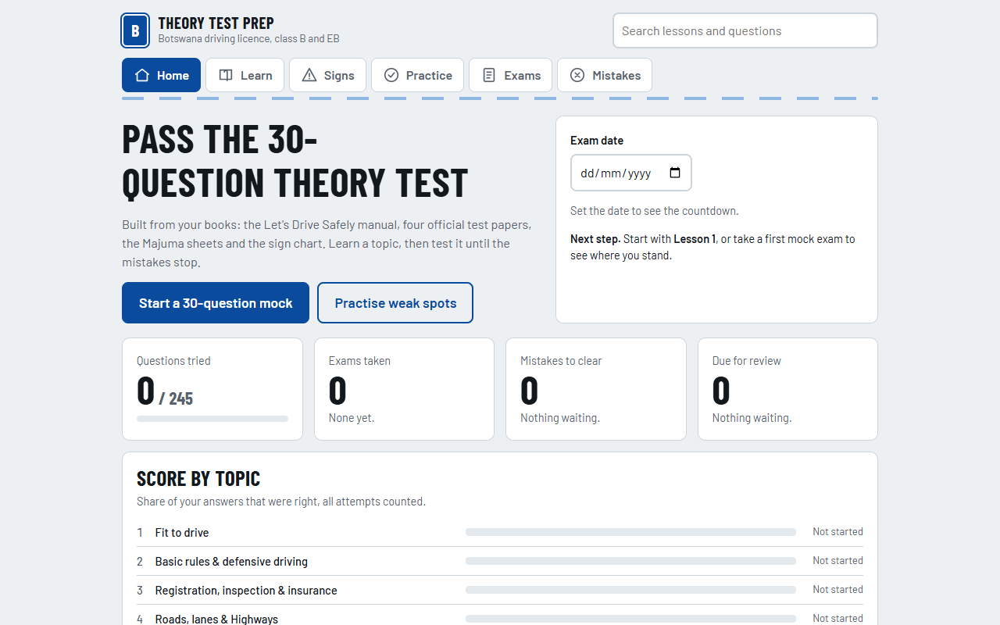

# Botswana Theory Test Prep

A study site for the Botswana driving theory test, class B and EB. It has fourteen lessons, a road-sign chart, a numbers sheet, practice questions and 30-question mock exams. It works offline, can be installed to a phone's home screen, and has no accounts or tracking.

**Live site:** https://fanwell23-025.github.io/Driving/



This is study material built from the owner's driving books. It is not an official government test. Confirm details with your testing station.

## Run it locally

The site has no build step, but it loads its data with `fetch`, so it needs a local web server rather than opening the file directly.

```sh
python -m http.server 8000
```

Then open http://localhost:8000/.

The service worker keeps serving its saved copy, so when testing changes use a private window or turn on "Bypass for network" in the browser's developer tools.

## How it is deployed

GitHub Pages serves the `main` branch from the repo root, so every push to `main` goes live within a minute or two. There is nothing else to deploy.

Phones pick up a new version the next time they open the site online. That relies on the version hash in `sw.js`, which the pre-commit hook keeps up to date.

## Before you commit

Turn on the hook once per clone:

```sh
git config core.hooksPath .githooks
```

It runs two scripts, which need only Node:

| Script | What it does |
| --- | --- |
| `node scripts/check-content.js` | Checks that answer indexes are valid, no option is empty, ids are unique and every referenced image exists. Also checks that the three disputed keys keep their notes and that the answer key has not changed. |
| `node scripts/build-precache.js` | Updates the list of offline files and the version hash in `sw.js`. |

GitHub Actions runs the same checks on every push.

If you change an answer on purpose, run `node scripts/check-content.js --update-answer-key` to accept the new key.

## Where things are

| Path | Contents |
| --- | --- |
| `index.html` | The page shell and metadata |
| `css/style.css` | All styles, including dark mode and print |
| `js/app.js` | The app |
| `js/config.js` | The settings you can edit |
| `data/data.json` | Questions, lessons, signs, test papers and the numbers sheet |
| `sw.js`, `manifest.webmanifest` | Offline support and installing to a phone |
| `img/`, `signs/` | Question pictures and road signs |
| `pages/` | Scanned manual pages: WebP, JPEG fallback and `thumbs/` |
| `fonts/` | Barlow and Barlow Condensed, under the licence in `fonts/OFL.txt` |

## Setting an exam time limit

The books do not state a time limit or a pass mark, so neither is set. To add a time limit, ask your testing station, then edit one line in `js/config.js`:

```js
examTimeLimitMinutes: 30
```

## Content and rights

The answer keys for Test 1 Q30, Test 4 Q3 and Majuma Parking Q1 disagree with the manual. Each of those questions carries a note explaining this.

`pages/` contains scans from the published manual "Let's Drive Safely", which remain the property of its publisher. This repo and the site are public, so anyone can see them.
